<!-- Generated by scripts/build_readme.mjs from the portfolio data (shaadqrsh/shaad-portfolio). Edit that, not this file. -->

<a href="https://www.shaadqrsh.com">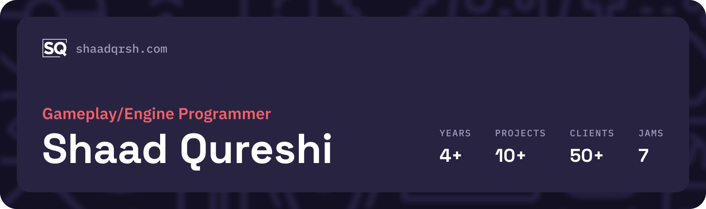</a>

I'm a Computer Science student with a background in AI, but I've always been a game developer at heart. It started with a Nintendo Wii when I was a kid, and I've loved games with their own worlds and stories ever since. Most of what I build is core gameplay, in C# for Unity and Blueprints for Unreal Engine. Freelancing has had me working with a lot of designers and figuring out how to make their more complicated ideas actually work in the engine. I want to work on games people love at a big studio, and one day make my own that gets the next generation of players hooked.

&nbsp;
&nbsp;
&nbsp;
&nbsp;

## Right now

<b>Masters of Science - Computer Science</b> 
Khoury College of Computer Sciences, Northeastern University, 2026 to 2028

 

<b>Media Services Technician</b> 
Northeastern University, running lighting, sound, and projection for live campus events

 

## Games

<table>
<tr>
<td width="50%" valign="top">

<a href="https://www.shaadqrsh.com/projects/countingsheep">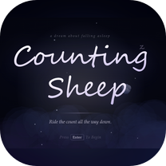</a>

<b>Counting Sheep</b> (2026) 
Solo 3D platformer for GMTK Game Jam 2026 where clouds fall apart under you. Rated 4.5/5 in most categories.

&nbsp;

</td>
<td width="50%" valign="top">

<a href="https://www.shaadqrsh.com/projects/harvestrush">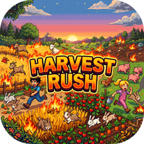</a>

<b>Harvest Rush</b> (2026) 
One or two player farming game like Overcooked. Fill the truck's order before pests and fires stop you.

&nbsp;

</td>
</tr>
<tr>
<td width="50%" valign="top">

<a href="https://www.shaadqrsh.com/projects/tictacgone">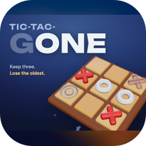</a>

<b>Tic-Tac-Gone</b> (2026) 
3D tic-tac-toe in the browser where you only keep three pieces, so a game can never end in a draw.

&nbsp;

</td>
<td width="50%" valign="top">

<b>Pokémon Bushido</b> (2021) 
Samurai fangame made by a team of 4 in 30 days. Won 1st of 31. I did the core engine work.

&nbsp;
&nbsp;

</td>
</tr>
<tr>
<td width="50%" valign="top">

<a href="https://www.shaadqrsh.com/projects/splice">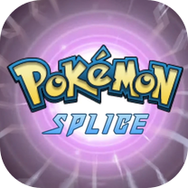</a>

<b>Pokémon Splice</b> (2020) 
Fangame with a form-changing starter and a branching story. Won 1st of 46, made by 4 people in 30 days.

&nbsp;

</td>
<td width="50%"></td>
</tr>
</table>

## Other projects

<b>SentinelDesk</b> (2026) 
IT ticket triage in English and German, built in a 6-hour hackathon. I led the team of five to 5th of 20. 

 

<a href="https://www.shaadqrsh.com/projects/nanorewind">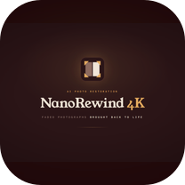</a><b>NanoRewind 4K</b> (2025) 
Restores scratched and faded family photos with Google Gemini in styles like Cyanotype or Kodachrome 64. 

&nbsp;

 

<a href="https://www.shaadqrsh.com/projects/sqllift">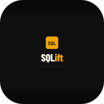</a><b>SQLift</b> (2026) 
Workout tracker with live set logging and leaderboards. I wrote Flask API modules and the CI/CD pipeline. 

&nbsp;

 

<b>CareerPath AI</b> (2025) 
AI career counselor that builds personalized roadmaps and "day in the life" previews. Built in 3 days. 

&nbsp;

 

<a href="https://www.shaadqrsh.com/projects/homi">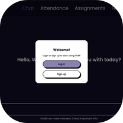</a><b>HOMI</b> (2025) 
Learning assistant for IT students that hands out study material, answers questions and writes practice tests. 

&nbsp;

 

<a href="https://www.shaadqrsh.com/projects/findly">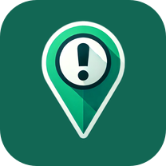</a><b>Findly</b> (2025) 
Android lost-and-found app with a live item feed and in-app chat. 

 

<a href="https://www.shaadqrsh.com/projects/emaadportfolio">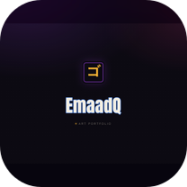</a><b>Artist Portfolio</b> (2026) 
Portfolio site for Emaad, an artist in my family, who adds and edits pieces through Decap CMS. 

&nbsp;

 

<b>shaadqrsh.com</b> (2026) 
My portfolio site. One data file builds every project page, the resume PDF and this GitHub profile. 

&nbsp;

 

## Jams and challenges

- **GDG Cloud Boston x Northeastern University Hackathon** (2026): 5th of 20 with SentinelDesk. Led a team of 5.
- **Roblox Racing Challenge** (2026): 1st place, Grand Prize. Wrote and tuned a Lua vehicle controller in one hour.
- **GMTK Game Jam** (2026): Counting Sheep, made solo in 96 hours.
- **IIT Madras Shaastra Techathon** (2024): Led a team of 4. Placed 2nd in my college and 116th in India.
- **Relic Castle Winter Jam #2** (2021): 1st of 31 with Pokémon Bushido.
- **Relic Castle Game Jam 6** (2020): 1st of 46 with Pokémon Splice.

## Publications

- [Building Trust in Transformers with a SHAP-Based Approach for Explaining AI Decisions](https://ieeexplore.ieee.org/document/11115248), IEEE Xplore, 2025
- [GPT vs. Open-Source LLMs: A Comprehensive Performance and Capability Assessment](https://www.ijert.org/gpt-vs--open-source-llms--a-comprehensive-performance-and-capability-assessment), IJERT, 2025

## GitHub activity

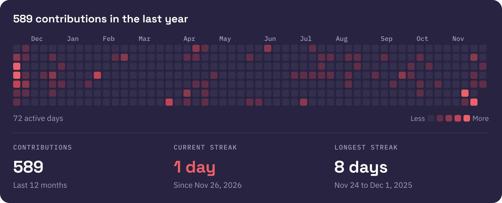

## Tools

**Engines & Tools**

  
  
  
  
  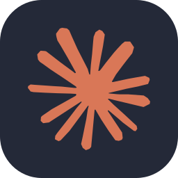
  
  
  
  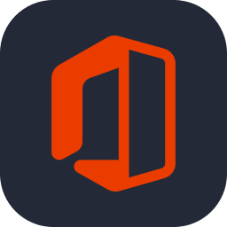

**Languages & Frameworks**

  
  
  
  
  
  
  
  

**Design & Practices**

Pixel Art, Project Management, UI Design, Level Design, Prompt Engineering, Problem Solving, Testing & Debugging, Collaboration & Teamwork, Time Management
